<div align="center">

<a href="https://inuxmax.github.io/JVcompany/">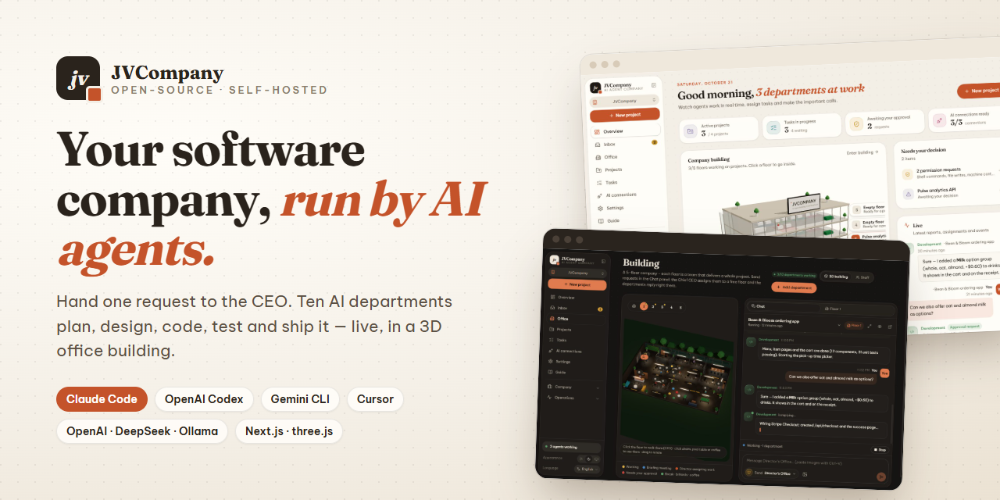</a>

# JVCompany — the AI Agent Software Company

**Run a whole software company with AI agents.** Give one request to the CEO; ten specialised AI departments plan, design, code, test, review and ship it — inside a live 3D office building you can walk around in.

[](LICENSE)
[](https://nextjs.org)
[](https://react.dev)
[](https://www.typescriptlang.org)
[](https://threejs.org)
[](https://www.mongodb.com)
[](https://www.electronjs.org)
[](https://github.com/inuxmax/JVcompany/stargazers)

[**🌐 Website**](https://inuxmax.github.io/JVcompany/) · [**🚀 Quick start**](#-quick-start) · [**✨ Features**](#-features) · [**🖼️ Screenshots**](#%EF%B8%8F-screenshots) · [**❓ FAQ**](#-faq)

</div>

---

## 📖 What is JVCompany?

**JVCompany** is an open-source, self-hosted **multi-agent orchestration platform** that models a real software company. Every department — CEO, Business Analyst, Project Manager, Scrum Master, UI/UX Studio, Architect/DevOps, Senior Developer, QA, Tester and Bug Fixer — is an **AI agent** with a role-specific system prompt, its own permissions and its own AI model.

You describe what you want once. The CEO scopes the work, breaks it into a **hand-off chain** (Design → Develop → Test → Fix → Re-test → QA review), assigns each step to the right department with the right permissions, and reports back when everything is done. Agents work **directly in your project folder on your computer**, can delegate to each other, ask you questions, request approvals and — if you allow it — **control your computer** (shell commands, mouse, keyboard, screenshots).

It plugs into the AI tools you already pay for: **Claude Code, OpenAI Codex, Gemini CLI, Cursor Agent, GitHub Copilot CLI, Qwen Code, OpenCode** (subscription CLIs), any **API key** (Anthropic Claude, OpenAI, Google Gemini, xAI Grok, DeepSeek, OpenRouter, Groq, Mistral), and fully local models via **Ollama** or **LM Studio**.

Runs in the **browser** or as a **desktop app** (Windows, macOS, Linux). Data stays on your machine in **MongoDB**.

> 💡 **Why?** Single coding agents are great at single tasks. Real software needs planning, design, implementation, testing and review — with someone checking the work. JVCompany gives your agents an org chart, a workflow, a budget and a boss.

## 📑 Table of contents

- [Highlights](#-highlights)
- [Screenshots](#%EF%B8%8F-screenshots)
- [How it works](#%EF%B8%8F-how-it-works)
- [Features](#-features)
- [Quick start](#-quick-start)
- [Desktop app](#%EF%B8%8F-desktop-app-electron)
- [Connecting AI models](#-connecting-ai-models)
- [Permissions & computer control](#%EF%B8%8F-permissions--computer-control)
- [Architecture](#%EF%B8%8F-architecture)
- [Configuration](#%EF%B8%8F-configuration)
- [Scripts](#-scripts)
- [FAQ](#-faq)
- [Contributing](#-contributing)
- [License](#-license)

## ⭐ Highlights

- 🏢 **10 ready-made AI departments** with role-specific prompts — add, edit or remove any of them.
- 🧑‍💼 **Delegate to the CEO** — one request in, a planned hand-off chain of tasks out, a final report back.
- 🔌 **Bring any AI** — subscription CLIs (Claude Code, Codex, Gemini CLI, Cursor…), API keys, local models, or even ChatGPT/Claude.ai in the browser.
- 🏙️ **A living 3D office** (three.js) — 5 floors, 5 projects in parallel; agents walk, meet, code, wait for you and play billiards based on real task state.
- 🛡️ **Four permission levels + approvals** — from read-only to full computer control; anything above the level asks you first.
- ⏳ **Rate-limit aware** — detects usage limits, waits for the exact reset time and resumes (Claude Code resumes the same session).
- 💰 **Costs & budgets** — tokens and cost per run, budgets per company/department/project with automatic pause at 100 %.
- 🌍 **10 UI languages** — English, Tiếng Việt, 简体中文, 日本語, 한국어, Español, Français, Deutsch, ไทย, Bahasa Indonesia. Agents answer in your language.
- 🔒 **Local-first & private** — binds to `127.0.0.1`, secrets encrypted with AES-256-GCM, API keys never sent to the browser.

## 🖼️ Screenshots

> The UI ships in 10 languages — English by default; switch any time from the **Language** button.

<table>
  <tr>
    <td width="50%">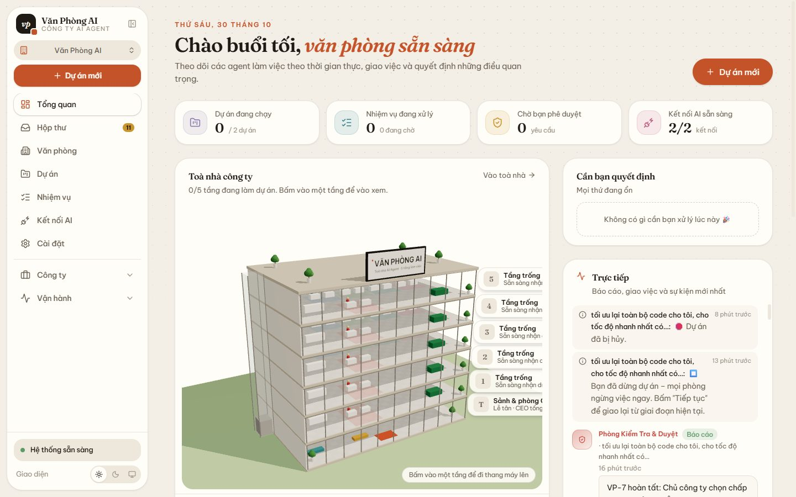<br><sub><b>Dashboard</b> — live projects, tasks, approvals and the company tower.</sub></td>
    <td width="50%">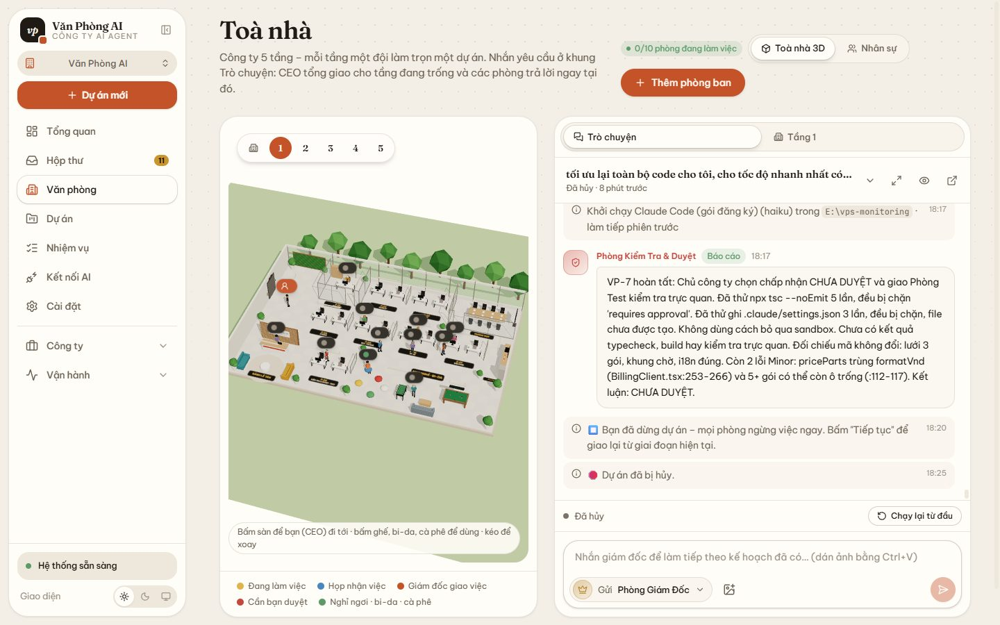<br><sub><b>3D office + chat</b> — talk to the CEO while agents work on the floor.</sub></td>
  </tr>
  <tr>
    <td>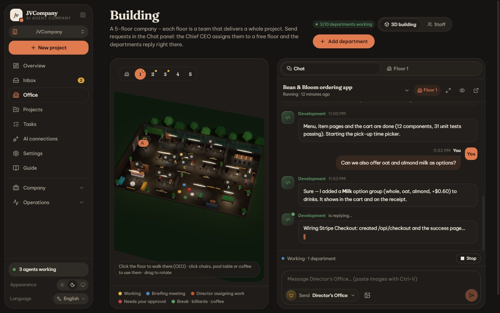<br><sub><b>Dark mode</b> — warm charcoal theme with lit desks.</sub></td>
    <td>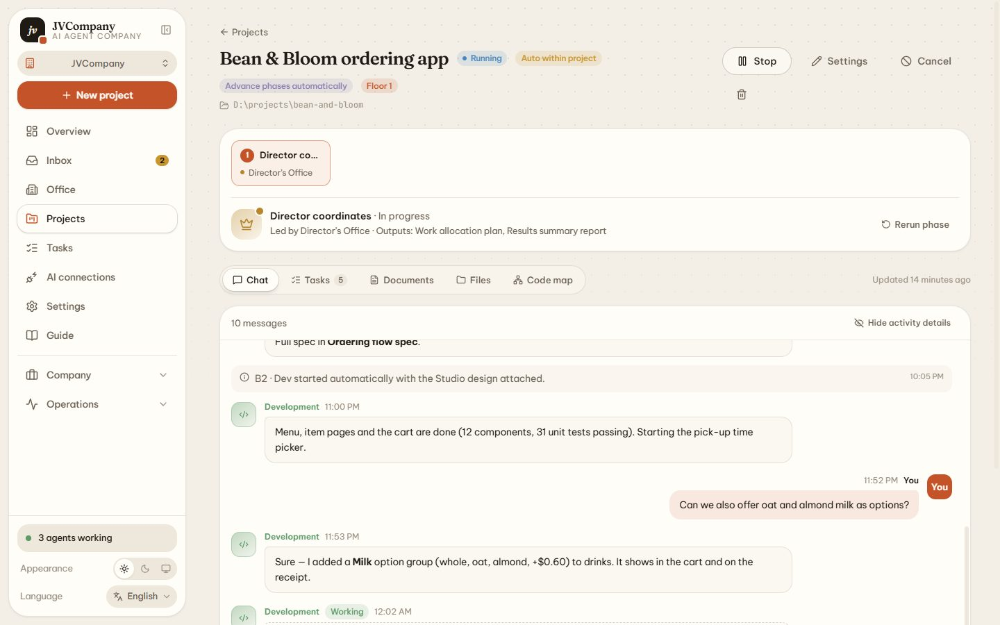<br><sub><b>Project</b> — stages, conversation, tasks, documents and files.</sub></td>
  </tr>
  <tr>
    <td>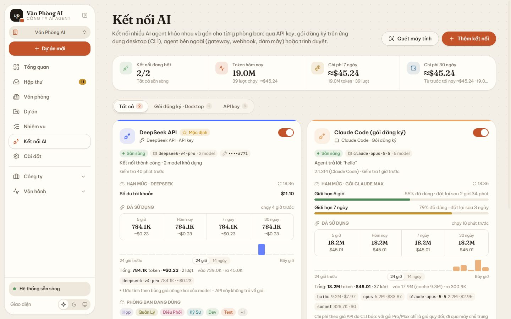<br><sub><b>AI connections</b> — CLIs and API keys with live usage limits and costs.</sub></td>
    <td>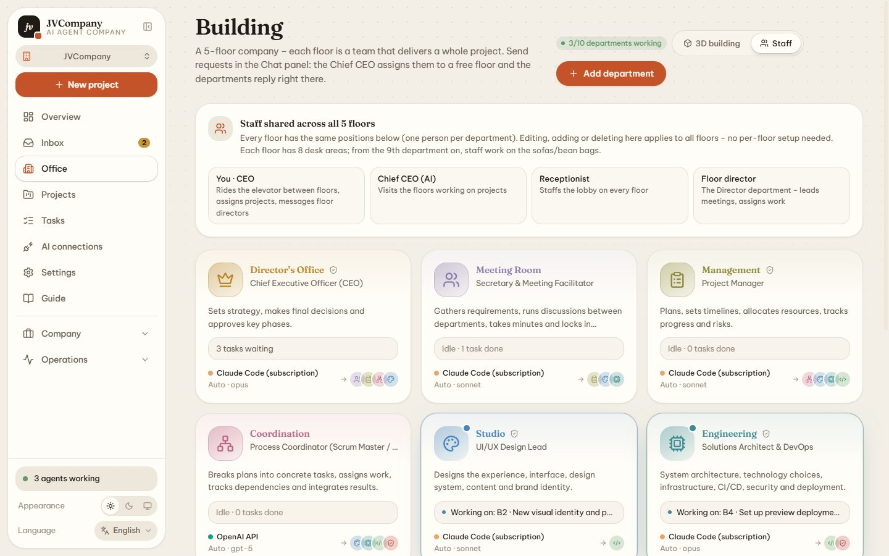<br><sub><b>Staff</b> — one roster shared by all five floors.</sub></td>
  </tr>
  <tr>
    <td>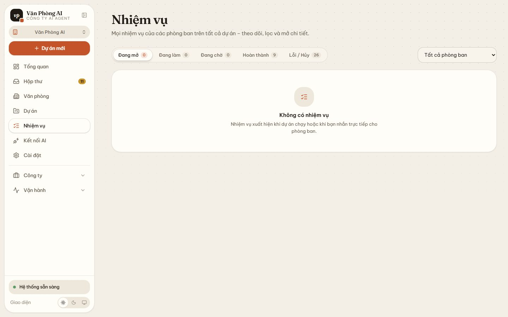<br><sub><b>Tasks</b> — every task of every department, filterable.</sub></td>
    <td>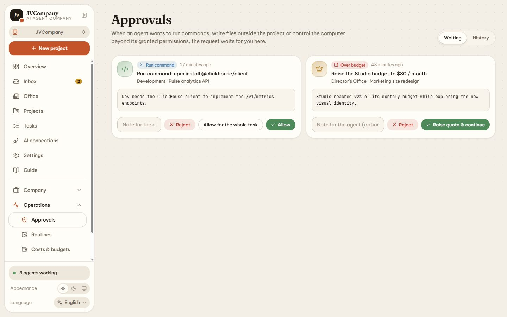<br><sub><b>Approvals</b> — allow once, for the whole task, or deny.</sub></td>
  </tr>
  <tr>
    <td>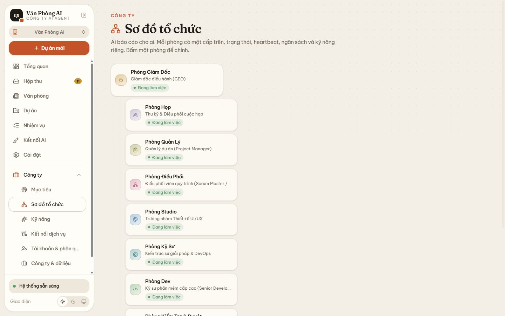<br><sub><b>Org chart</b> — managers, heartbeats, budgets, config history.</sub></td>
    <td>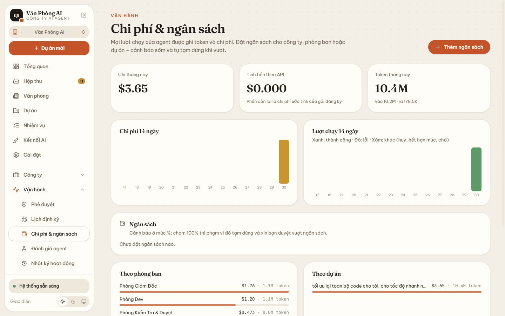<br><sub><b>Costs & budgets</b> — spend per run, department and project.</sub></td>
  </tr>
</table>

More screenshots live in [`public/guide/`](public/guide) and on the [website](https://inuxmax.github.io/JVcompany/#screenshots).

## ⚙️ How it works

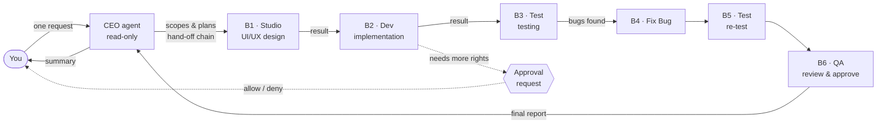

1. **You** send a request from the chat (optionally pick a project folder and attach images).
2. The **CEO tower agent** finds a free floor (or queues the project) and hands it to that floor's **director**.
3. The director scopes the work and creates a **hand-off chain**: each step has an ID (B1, B2…), a department, a permission level and "runs after step X". Later steps wait in *Waiting for hand-off* and start automatically with the previous step's output attached.
4. If a step fails or is cancelled, the chain stops and the director is called back to decide. When everything is done the director writes the final report.
5. Any action above a step's permission level becomes an **approval request** in your inbox.

Prefer a classic process? Switch the project to the **7-stage workflow**: Idea → Design → Planning → Development → Review → Approval → Deployment, with a lead department per stage and reviewers who can send work back with feedback.

## ✨ Features

### 🏢 Departments & people
- **10 standard departments**: CEO, Meeting (BA), Manager (PM), Coordinator (Scrum Master), Studio (UI/UX), Engineer (Architect/DevOps), Dev (Senior Developer), Review & Approve (QA), **Test** (Tester) and **Fix Bug** (Bug Fixer).
- Edit prompts, permissions and who-can-delegate-to-whom; add or remove departments at any time.
- **Org chart** with managers and reports, status (active / paused / error / off / pending hire), **heartbeats** (agents wake up on a schedule to review their work, with daily run/cost caps), monthly budgets, skills, environment variables and **config history with rollback**.
- Directors can propose **hiring new staff** (optionally requiring your approval).

### 🧑‍💼 Delegate to the director (default mode)
- You hand off a request once; the director scopes it and splits it across departments by expertise.
- **Per-task permissions** (read-only / edit files / run commands / full) — never above the project's or department's limit. The director itself is read-only, so it can't do the work for its team.
- Hand-off chains with dependencies, automatic start, result forwarding, stop-on-failure and a final summary report.

### 🏙️ 5-floor 3D building (three.js / React Three Fiber)
- Each floor is a team working on **one project** — up to **5 projects in parallel**; the 6th project waits in a *Waiting for a free floor* queue and moves in automatically.
- Realistic open-plan floors: zones P.01–P.08, a meeting room, reception, coffee bar and a lounge with **billiards**, foosball and bean bags.
- Agents **move based on real data**: typing at their desks while working, gathering in the meeting room when the director assigns work, standing and waiting when they need your approval, playing billiards or grabbing coffee when idle.
- The **tower CEO** (AI) rides the elevator between busy floors. **You are a CEO too**: pick a floor and you press the elevator button, the doors close, the floor counter ticks, and you step out on the new floor.
- Automatic card-view fallback without WebGL; animations off when the OS asks for *reduced motion*.

### 💬 Chat with images
- A ChatGPT/Claude-style chat beside the 3D scene. Every conversation is a project; replies stream live.
- Paste (Ctrl+V), drag-and-drop or attach up to 6 images × 5 MB (PNG/JPG/WEBP/GIF). API providers receive images directly; CLIs receive file paths; images are forwarded to delegated tasks too.

### 🔁 Workflows, goals & routines
- **Goal tree** (company → team → person → task); agents receive the goal chain, manager chain and parent task in their prompt.
- Tasks have IDs like **JV-123**, 4 priorities, labels, comments (re-opens finished work), work products (PRs, commits, preview links) and **multi-step approvals**.
- **Routines** create tasks on a **cron** schedule (with time zone), via **webhook** (Bearer or HMAC-SHA256, de-duplicated with `Idempotency-Key`) or **API**; coalesce/skip overlapping runs, catch up missed runs, template variables like `{{date}}`.

### 💰 Costs, budgets & reliability
- Every **run** records tokens, cost, session before/after and why it woke up. Silent runs are watched (5/15 min) with Continue / Snooze / Skip / Stop.
- Budgets per company, department or project (monthly or lifetime): warnings at a threshold, **automatic pause at 100 %** with a request to raise the limit.
- **Auto-retry on usage limits**: understands `429`, "usage limit reached", "resets 3pm", `retry-after`…; waits for the reset and retries, or switches to a **fallback connection** immediately.

### 🔐 Secrets, skills, plugins & audit
- **Secret vault** encrypted with AES-256-GCM; reference as `NAME=secret:KEY` in environment variables; masked in logs.
- **Skills** (`SKILL.md` — write your own, or import from GitHub / URL / folder, versioned) assigned to departments.
- **Plugins** — install pre-built packs or from npm / GitHub.
- **MCP service connections** (GitHub, Notion, any MCP server) with per-action Allow / Ask first / Off, and **chat channels** to message the office from your phone.
- **Agent evals** — eval suites with saved runs and a fingerprint of the prompt + skills used.
- **Activity log** of every important change; **team templates**; **export / import a company** as JSON (secrets stripped).
- **Accounts & roles** — turn on sign-in and give each person their own account and role.

### 🚀 Onboarding & UX
- Empty database → a 4-step setup: company name & mission → pick a team template → connect models (auto-detects installed CLIs, **environment check**) → start with a "Getting started" project where the CEO greets you.
- **Realtime** everything via Server-Sent Events: conversations, tool logs, task states, Kanban, artifacts and project files.
- "Paper & Ink" design: warm paper, ink text, terracotta accents (warm charcoal in dark mode); Fraunces + Be Vietnam Pro. Floating top nav on desktop, bottom tab bar on phones.

## 🚀 Quick start

### Requirements

- **Node.js ≥ 20**
- **MongoDB** — local (`mongodb://127.0.0.1:27017`) or MongoDB Atlas
- *(optional)* signed-in agent CLIs: `claude`, `codex`, `gemini`, `cursor-agent`, `copilot`, `qwen`, `opencode`

### One command (recommended)

```bash
npx create-jvcompany@latest
```

[`create-jvcompany`](packages/create-jvcompany) downloads the latest source, creates `.env.local`, checks MongoDB (and offers to start it in Docker), installs the dependencies and opens **http://127.0.0.1:2501** — where a 4-step setup creates your company. Use `npx create-jvcompany@latest my-office --yes` to skip the questions; see `--help` for all options.

No MongoDB yet?

```bash
docker run -d --name jvcompany-mongo -p 27017:27017 -v jvcompany-mongo:/data/db mongo:8
```

### Manual install

```bash
git clone https://github.com/inuxmax/JVcompany.git
cd JVcompany
npm install
cp .env.example .env.local      # edit MONGODB_URI if needed
npm run dev                     # → http://127.0.0.1:2501
```

On first launch the app automatically:

1. Creates default data in MongoDB (database `jvcompany`): departments, workflow, settings.
2. Imports legacy data from `data/*.json` if present.
3. Scans your computer and adds every agent CLI it finds, plus a "Browser" connection.

## 🖥️ Desktop app (Electron)

```bash
npm run desktop                          # development (starts next dev on its own port)
npm run build && npm run desktop:prod    # run the production build
npm run desktop:build                    # package installers (Windows NSIS / macOS DMG / Linux AppImage) into dist-desktop/
```

The desktop app uses the native folder picker and opens external links in your default browser. A packaged install still needs MongoDB (or `MONGODB_URI` in a `.env.local` next to the app).

## 🔌 Connecting AI models

Open **AI connections**:

| Type | What you get |
|---|---|
| **API key** | Claude, OpenAI, Gemini, Grok (xAI), DeepSeek, OpenRouter, Groq, Mistral, Ollama, LM Studio and any OpenAI-compatible endpoint. Paste the key → *Save & test* (model list loads automatically). Keys are stored in your local MongoDB and never sent to the browser. |
| **Subscription · Desktop CLI** | Claude Code, OpenAI Codex, Gemini CLI, Cursor Agent, GitHub Copilot CLI, Qwen Code, OpenCode, Pi, Kimi Code, Grok Build, Hermes or a custom command. Install and sign in once (e.g. `claude` with a Claude Pro/Max account, `codex login` with ChatGPT), then *Scan computer*. Each CLI can use its **subscription or an API key**, custom env vars, working directory and time limit. **Environment check** runs a "hello" test and reports Pass / Warning / Error with fixes. |
| **External agents** | Hermes Gateway (HTTP + SSE), OpenClaw Gateway (WebSocket, Ed25519 device pairing), Cursor Cloud Agent (works on a GitHub repo and opens PRs) and any **HTTP webhook** (respond inline or call back `/api/agent-callback/<runId>`). |
| **Subscription · Browser** | ChatGPT / Claude.ai / Gemini / Grok: the task shows *Copy prompt*, opens the site, and you paste the answer back (it can return `files` to write into the project). |

Each department picks its own connection (or *Auto* by priority), a **model tier** — Premium / Balanced / Fast, mapped automatically (e.g. Opus / Sonnet / Haiku, GPT-5 / GPT-5 mini) — and a **fallback connection**.

The Claude API uses `claude-opus-5-5` for the Premium tier with `fallbacks: "default"` (beta `server-side-fallback-2026-07-01`), automatic prompt caching and streaming.

## 🛡️ Permissions & computer control

| Level | Read | Write | Shell | Outside project folder | Mouse / keyboard / screenshots |
|---|:-:|:-:|:-:|:-:|:-:|
| Read-only | ✅ | ❌ | ❌ | ask (read) | ❌ |
| Read & write | ✅ | ✅ | ask | ask | ask\* |
| Auto inside project | ✅ | ✅ | ✅ (in project) | ask | ask\* |
| Full computer access | ✅ | ✅ | ✅ | ✅ | ✅\* |

\* requires **Settings → Allow AI to control the computer**. macOS needs Accessibility + Screen Recording permissions; Linux needs `xdotool` and a screenshot tool (`gnome-screenshot` / `scrot` / ImageMagick).

For CLI agents the level maps to the CLI's own mode — e.g. Claude Code: `plan` / `acceptEdits` / `acceptEdits + Bash` / `--dangerously-skip-permissions`; Codex: `read-only` / `workspace-write` / `danger-full-access`.

**Security:** the server listens on `127.0.0.1` only and rejects requests that don't come from this machine (with CSRF protection). To use it from another device on your LAN, set `JVCOMPANY_ACCESS_KEY` in `.env.local`, run `next dev -H 0.0.0.0 -p 2501` and open `http://<ip>:2501/?key=<your-key>` once.

## 🏗️ Architecture

```
app/                     UI (Next.js 16 App Router) + API route handlers
  api/…                  REST: projects, tasks, departments, providers, approvals, floors, fs, events (SSE)…
components/              UI kit, app shell, project boards, task drawer, approval cards
  office-view.tsx        Lazy-loads the 3D scene + non-WebGL fallback
  code-graph-3d.tsx      3D code map of a project (three.js)
  building/              3D building (React Three Fiber)
    layout.ts            Floor plan: department zones, meeting room, lobby, lounge, seats
    nav.ts               Occupancy grid + A* path finding
    sim.ts               Character behaviour (work, meetings, breaks, billiards…) + CEO route
    person.tsx           Rigged low-poly characters + animation
    props.tsx            Furniture: desks, chairs, billiard table, sofas, plants, glass walls, elevator…
    floor-scene.tsx      Single-floor scene
    tower-scene.tsx      Whole-building scene + elevator shaft
    elevator-doors.tsx   Elevator doors + floor counter when changing floors
lib/
  types.ts, catalog.ts   Shared types + catalogues (connections, permissions, statuses)
  i18n/                  10 UI languages
  client/                API client, realtime SSE → SWR, formatting
  server/
    db.ts, repo.ts       MongoDB: connection, indexes, seed, queries
    seed.ts              10 departments + role prompts, delegate-to-director mode + 7-stage workflow
    fsbrowse.ts          Drive / folder browser, project detection
    computer.ts          Screenshots, mouse, keyboard, launching apps (Windows/macOS/Linux)
    agent/
      worker.ts          Task queue, parallel runs, worker heartbeat, auto-retry
      runner.ts          Picks connection & model, runs the agent, handles delegation / rate limits
      orchestrator.ts    Floor/queue → stage → lead → delegate → summarise → approve → release floor
      prompts.ts         Role system prompts + project context + result protocol
      tools.ts           Agent tools: files, commands, computer, delegation, documents, submit result
      permissions.ts     Permission checks + approval flow
      providers/         anthropic (Claude SDK) · openai (OpenAI-compatible) · cli · manual (web)
desktop/                 Electron: main, preload, packaging config
docs/                    GitHub Pages website
instrumentation.ts       Starts the worker with the server
proxy.ts                 Local-only access + CSRF protection
```

**MongoDB collections:** `departments`, `providers`, `workflows`, `projects`, `tasks`, `messages`, `approvals`, `artifacts`, `events` (3-day TTL), `settings`, `floors`, `meta`.

**Tech stack:** Next.js 16 (App Router) · React 19 · TypeScript · Tailwind CSS 4 · three.js + React Three Fiber + drei · MongoDB · SWR + Server-Sent Events · Electron · Anthropic SDK · OpenAI SDK · Cursor SDK.

## ⚙️ Configuration

| Variable | Default | Description |
|---|---|---|
| `MONGODB_URI` | `mongodb://127.0.0.1:27017` | MongoDB connection string |
| `MONGODB_DB` | `jvcompany` | Database name |
| `JVCOMPANY_ACCESS_KEY` | – | Enables LAN access with this key |
| `JVCOMPANY_WORKER` | – | `off` disables the agent worker in this instance |
| `JVCOMPANY_DATA_DIR` | `.jvcompany/` | Workspace for projects that are not linked to a folder |
| `JVCOMPANY_PUBLIC_URL` | `http://127.0.0.1:2501` | Public URL external agents call back to |
| `NEXT_DIST_DIR` | `.next` | Build directory (desktop dev uses `.next-desktop`) |

Translations: see [`lib/i18n/README.md`](lib/i18n/README.md); find untranslated strings with `npm run i18n:check`.

## 📜 Scripts

```bash
npm run dev          # development server on http://127.0.0.1:2501
npm run build        # production build
npm run start        # run the production build on port 2501
npm run typecheck    # TypeScript
npm run lint         # ESLint
npm run i18n:check   # untranslated UI strings
npm run desktop      # Electron desktop app
node scripts/demo-seed.cjs                          # English demo company in the jvcompany_demo database
npx electron scripts/guide-screenshots.cjs --demo   # re-capture the screenshots in public/guide
```

## ❓ FAQ

<details>
<summary><b>Is JVCompany free?</b></summary>

Yes. It is open source under the MIT license and runs on your own computer. You only pay for the AI you connect — or nothing at all with local models (Ollama, LM Studio) or the subscriptions you already have (Claude Pro/Max, ChatGPT, Gemini…).
</details>

<details>
<summary><b>Which AI models and coding agents are supported?</b></summary>

Claude Code, OpenAI Codex, Gemini CLI, Cursor Agent, GitHub Copilot CLI, Qwen Code, OpenCode and custom CLIs; API keys for Anthropic Claude, OpenAI, Google Gemini, xAI Grok, DeepSeek, OpenRouter, Groq, Mistral and any OpenAI-compatible endpoint; local models via Ollama and LM Studio; external agents via Hermes, OpenClaw, Cursor Cloud Agent or HTTP webhooks. Each department can use a different model.
</details>

<details>
<summary><b>Does my code leave my machine?</b></summary>

The app itself runs locally and binds to `127.0.0.1`. Your code is only sent to the AI provider you choose for a department — use a local model if nothing may leave your computer.
</details>

<details>
<summary><b>Can agents break my computer?</b></summary>

Each project and department has a permission level (read-only → full access). Anything above it becomes an approval request you must accept. Computer control (mouse, keyboard, screenshots) is off until you enable it in Settings.
</details>

<details>
<summary><b>What happens when I hit a usage limit?</b></summary>

The run is paused, the reset time is read from the error ("resets 3pm", `retry-after`…), and the task resumes automatically — or switches to the department's fallback connection right away.
</details>

<details>
<summary><b>Do I need a GPU for the 3D office?</b></summary>

No. Any browser with WebGL works; without WebGL the office switches to a card view automatically.
</details>

## 🤝 Contributing

Issues and pull requests are welcome! Before opening a PR:

```bash
npm run typecheck && npm run lint && npm run i18n:check
```

Keep UI strings translatable (`t('…')`) and follow the existing code style. If you like the project, please **⭐ star the repo** — it really helps others find it.

## 📄 License

[MIT](LICENSE) © JVCompany contributors

<div align="center"><sub>JVCompany · AI agent software company · multi-agent orchestration for Claude Code, Codex & Gemini CLI · 3D office simulation</sub></div>
